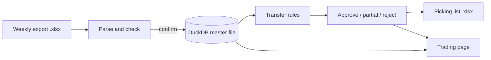

# Retail transfer engine

A small Streamlit app that suggests stock transfers between the stores of a four-store fashion retailer, lets a person approve them, and produces the picking list the stores work from.

It's a portfolio project. It runs on **synthetic data** generated by the repo itself; no real business data is included.

## What it does

Each week:

1. **Upload** the weekly sales and stock export (a Power BI Excel file). The app checks it and shows a preview before anything is saved.
2. **Get transfer suggestions.** Two rules look at every style-colour across the four stores:
   - **Moves:** a store that sells the line well and is about to run out gets stock from a store where it isn't selling.
   - **Tidy-ups:** a slow line spread thinly over several stores is pulled into the one store that sells it best.
3. **Decide** on each suggestion (approve, approve only some sizes, or reject with a note), then download an **Excel picking list** grouped by sending store.
4. **Review trading:** sales against last week and last year by store and category, slow movers, and a check on whether last week's approved transfers actually arrived.



## Quick start

Needs Python 3.12+.

```bash
python3.12 -m venv .venv && source .venv/bin/activate
pip install -e ".[dev]"

# Make a synthetic data folder (gitignored), seed the database, start the app
python scripts/make_synthetic_data.py
export RETAIL_DATA_DIR=data/local/synthetic RETAIL_CONFIG=data/local/synthetic/config.json
python scripts/seed_db.py
streamlit run app.py
```

The synthetic folder also holds next week's export (`week43-2026.xlsx`), so you can try the upload page straight away.

Run the tests with `pytest`.

## The transfer rules

All thresholds live in [`config/config.example.json`](config/config.example.json). A suggestion always moves a store's **whole run** of a style-colour (every size it holds), and lines on automatic replenishment (with a *norm*) are never touched.

**Moves.** Rate = units sold per week over the last 4 weeks; cover = stock ÷ rate.
- *Receiver:* sells at least 0.5 a week and has under 4 weeks of cover, counting stock already on its way.
- *Donor:* not a receiver, holds at least 3 units, has 12+ weeks of cover (no sales = unlimited), and the line has been in store at least 4 weeks.
- Donors go most-stock first, each to the fastest-selling receiver that would stay at or under 12 weeks of cover. The receiver's stock is updated before the next donor is matched.

**Tidy-ups.** A line not in a move, held in 2+ stores with no store above 5 units, first stocked 6+ weeks ago, and slow across the chain (12+ weeks of cover at the 8-week rate). Accessories only when the chain holds 12 or fewer. Every holder sends its run to the store that sold the most in 8 weeks.

The rules are pure functions in [`rules.py`](transfer_engine/rules.py): a table goes in, suggestions come out, and each suggestion carries a reason in plain words. They're tested on small hand-made tables in [`test_rules.py`](tests/test_rules.py).

## Design choices

- **One DuckDB file is the master copy.** Weekly exports are added to it and then deleted, so it keeps every column the export has, even ones no rule uses yet.
- **Uploads are all-or-nothing.** The database is backed up first (the last 4 are kept); the week's rows are replaced in one transaction; the export file is deleted only after that succeeds. A failed upload changes nothing and can simply be retried.
- **Checks before saving:** exactly one week, every store present, and total sales at least 60% of last week and of last year. Low sales can be overridden after a person confirms them, since a store may really have been closed.
- **Stable run IDs.** A suggestion's ID is a hash of its week, line and stores, so regenerating a week keeps decisions on unchanged suggestions.
- **Missing isn't zero.** A change against a week with no sales is shown blank, not as 0% or infinity.
- **ISO weeks throughout**, so 53-week years (like 2026) work.
- **Real data stays outside the repo.** Paths come from `RETAIL_DATA_DIR` in a gitignored `.env`; store names and other business-specific values live in a config file next to the data. The repo ships made-up values in the same shape.
- **Typed, strict config.** The config is loaded into read-only dataclasses, and a missing or misspelled key stops the app at start-up.

## Project layout

```
app.py                     Streamlit entry point (three pages)
app_pages/                 upload.py, transfers.py, trading.py
transfer_engine/
  settings.py              .env + config loading, typed and validated
  storage.py               DuckDB schema, seed load, week replace, backups
  export.py                Power BI export parser (pure function)
  checks.py                upload checks and preview
  upload.py                backup → save → delete export
  lines.py                 builds the rules' input from history (the only SQL the rules depend on)
  rules.py                 moves and tidy-ups (pure functions)
  batch.py                 runs the rules for a week, saves suggestions
  decisions.py, picking.py approve / partial / reject, Excel picking list
  trading.py               sales summaries, slow movers, transfer follow-up
  weeks.py                 ISO week arithmetic
  synthetic.py             the synthetic data generator
scripts/                   seed_db.py, make_synthetic_data.py, relabel_categories.py
tests/                     pytest, one file per module
```

## Known limitations

- **Censored demand.** The receiver's rate counts sales, and sales stop when a store runs out, so a store that sold out more than 4 weeks ago can't receive, even if it needs the line most. Measuring the rate only over weeks with stock would fix this.
- **The transfer follow-up is an estimate** from stock movement; deliveries from the warehouse or returns can blur it.
- **"First stocked" is measured chain-wide**, so a store that only just received a line can still donate it.
- Single user, local only: there's no login and no concurrent editing.
